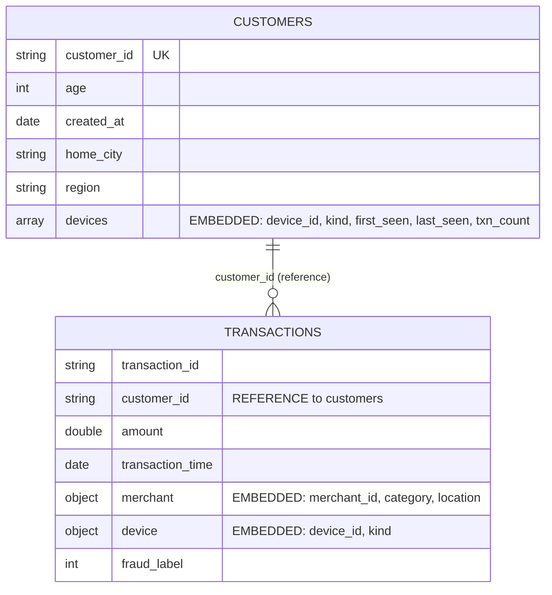
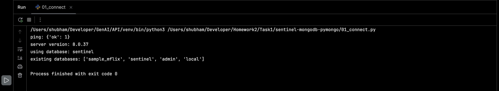
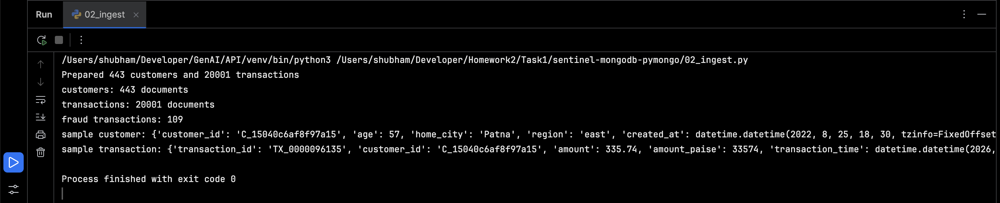
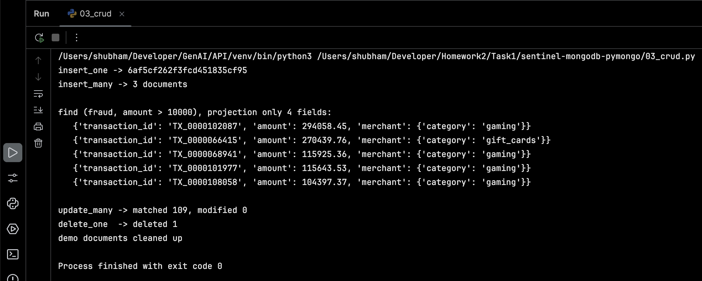
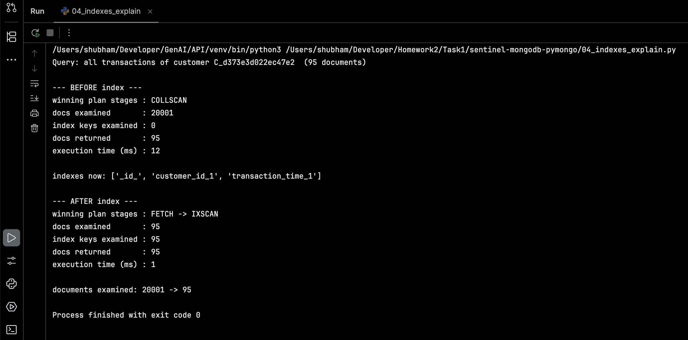
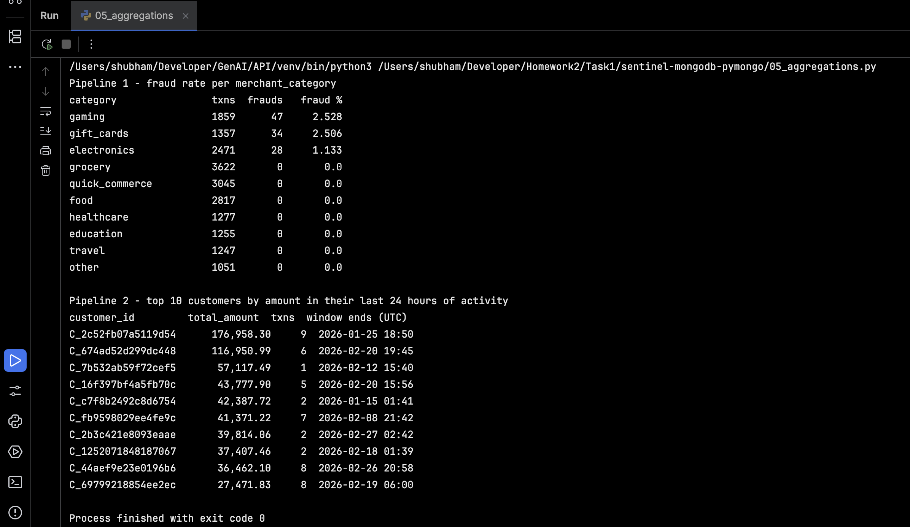

# SENTINEL on MongoDB Atlas with Python (pymongo)

Week task 1 - Super30. I take the PayVista SENTINEL fraud transactions, load them into
MongoDB Atlas, and then do the usual work: CRUD, indexes with `explain()`, and two aggregation pipelines.

**Problem in one line:** fraud analysts need to ask questions like "which merchant category
has the most fraud?" and "who spent the most in their last day?" fast. This repo shows how
to model the data in MongoDB so those questions are cheap to answer.

## What is in here

| File | What it does |
|---|---|
| `config.py` | Reads settings from `.env`, creates the `MongoClient` |
| `01_connect.py` | Connects to Atlas and pings it |
| `02_ingest.py` | Builds the `customers` and `transactions` collections and loads 5,000+ transactions |
| `03_crud.py` | `insert_one`, `insert_many`, `find` (filter + projection), `update_many`, `delete_one` |
| `04_indexes_explain.py` | Indexes on `customer_id` and `transaction_time`, `explain()` before and after |
| `05_aggregations.py` | Fraud rate per merchant category, top 10 customers in their last 24 hours |
| `.env.example` | Template for secrets (the real `.env` is git-ignored) |

## Setup

### 1. Create the Atlas cluster (free M0)
1. Sign up at [mongodb.com/atlas](https://www.mongodb.com/atlas) and create a free **M0** cluster.
2. **Database Access** -> Add Database User -> username + password -> role **Read and write to any database**.
3. **Network Access** -> Add IP Address -> add your current IP (or `0.0.0.0/0` for a short demo only, then remove it).
4. **Connect** -> Drivers -> copy the connection string.

### 2. Get the code and install
```bash
git clone <this-repo-url>
cd sentinel-mongodb-pymongo
python -m venv .venv && source .venv/bin/activate      # Windows: .venv\Scripts\activate
pip install -r requirements.txt
```

### 3. Add your secrets
```bash
cp .env.example .env
```
Open `.env` and set `MONGODB_URI` (your connection string with your own user and password;
if the password has special characters like `@`, URL-encode them, e.g. `%40`) and
`DATA_DIR` (path to the kit's `data/tables` folder).
`.env` is in `.gitignore`, so keys and passwords are never committed.

### 4. Data
The data is the SENTINEL **supabase_db_kit** from the instructor (110,000 transactions, 2,500 customers,
200 merchants, 10,120 devices, all synthetic). It is the same data that `python ingest.py all` loads into Supabase;
here I read its `data/tables/*.csv.gz` files directly and load them into MongoDB instead.
Unzip the kit anywhere and set `DATA_DIR` in `.env` to its `data/tables` folder.
Tables used: `transactions`, `labels` (holds `fraud_label`, joined on `transaction_id`), `customers`, `merchants`, `devices`.
The kit is not committed to this repo (large data, not mine to republish).

## How to run
```bash
python 01_connect.py
python 02_ingest.py
python 03_crud.py
python 04_indexes_explain.py
python 05_aggregations.py
```
Every script can be re-run: `02` rebuilds the collections, `03` cleans up its own demo documents.

## Design: two collections



**Customers -> transactions: REFERENCE (by `customer_id`).**
A customer's transactions only ever grow. Embedding them would make one customer document bigger forever
and MongoDB has a 16 MB limit per document. Also, almost every analytics question
(fraud per category, amount per day) is about *transactions*, not about one customer, so they must be
their own collection that I can index and aggregate directly.

**Devices -> customer: EMBED (array inside the customer).**
A customer uses only a handful of devices, the list is small and bounded, and I always read it together with the customer
("which devices has this person used?"). One read gets it all, no join needed.

**Merchant and device details inside each transaction: EMBED (a snapshot).**
Merchants (only 200) and devices have their own tables in the kit, but my queries only need a few fields
(merchant category and city, device kind). Copying those into each transaction means the fraud-per-category pipeline
needs no `$lookup`. The merchant and device IDs are kept too, so I can still find the full record later.
The trade-off: this data is duplicated, which is fine because a transaction is a historical fact
that should not change later.

**Trade-off I accepted:** the `devices` array in `customers` and the `device` field in `transactions` repeat
some information. Reads are fast and simple, and the duplication is small. If device data became large or changed often,
I would move it to its own collection.

**Sampling:** the kit has 110,000 transactions. `02_ingest.py` loads whole customers
(all of their transactions) until it reaches `TARGET_TXNS` (default 20,000; the task needs at least 5,000; set `0` to load everything).
I sample customers, not random rows, so each customer keeps their history, which the "last 24 hours" pipeline needs.

## What each step shows

### CRUD (`03_crud.py`)
- `insert_one` - one new demo customer
- `insert_many` - three demo transactions for that customer
- `find` with a filter (`fraud_label = 1` and `amount > 10000`) and a **projection** (only `transaction_id`, `amount`, `merchant.category`)
- `update_many` - sets `review_status = "flagged"` on every fraud transaction
- `delete_one` - removes one demo transaction

### Indexes and explain() (`04_indexes_explain.py`)
Indexes: `customer_id` and `transaction_time` on `transactions`.
Query used: all transactions of one customer.
`explain()` shows the plan changing from `COLLSCAN` (reads every document) to `FETCH -> IXSCAN`
(jumps straight to that customer's documents). Example from my test run on 20,001 documents:

| | Stage | Docs examined | Keys examined | Returned | Time |
|---|---|---|---|---|---|
| Before | COLLSCAN | 20,001 | 0 | 95 | 12 ms |
| After | FETCH -> IXSCAN | 95 | 95 | 95 | 1 ms |

### Aggregations (`05_aggregations.py`)
1. **Fraud rate per `merchant_category`** - `$group` on `merchant.category`, `$sum` for fraud count, `$avg` of the 0/1 `fraud_label` as the rate, then `$sort`.
2. **Top 10 customers by amount in their last 24 hours** - "last 24 hours" is measured per customer, backwards from *their own* latest transaction.
   `$setWindowFields` adds each customer's latest time to every row, `$match` + `$dateSubtract` keeps the last 24 hours,
   `$group` sums the amount, `$sort` + `$limit 10`. Needs MongoDB 5.0 or newer (Atlas M0 is 7.x or 8.x).

## Screenshots of output
Real output from my runs against Atlas (MongoDB 8.0.37).

### 1. Connect (`01_connect.py`)
Ping returns `{'ok': 1}`, server version 8.0.37, using the `sentinel` database.



### 2. Ingest (`02_ingest.py`)
443 whole customers sampled, giving 20,001 transactions, 109 of them fraud.



### 3. CRUD (`03_crud.py`)
`insert_one`, `insert_many` (3 docs), `find` with a filter and projection (top fraud transactions over 10,000, mostly `gaming`),
`update_many` matched all 109 fraud transactions, `delete_one` deleted 1, then the demo documents are cleaned up.
(`modified 0` is expected on a re-run: the fraud rows were already flagged by an earlier run.)



### 4. Indexes and explain() (`04_indexes_explain.py`)
`COLLSCAN` over 20,001 docs (12 ms) becomes `FETCH -> IXSCAN` over 95 docs (1 ms).



### 5. Aggregations (`05_aggregations.py`)
Fraud is concentrated in `gaming` (2.53%), `gift_cards` (2.51%) and `electronics` (1.13%); every other category has 0 fraud in this sample.
The top customer spent 176,958.30 across 9 transactions in their last 24 hours.



## Notes
- Timestamps are stored as BSON dates (UTC). The client is created with `tz_aware=True`, so they come back with timezone info.
- `amount_paise` is kept as the exact integer amount; `amount` (rupees) is derived from it.
- `fraud_label` lives in a separate `labels` table in the kit, so the loader joins it to each transaction (one label per transaction, checked).
- Never commit `.env`. If a password ever leaks, rotate it in Atlas -> Database Access.
